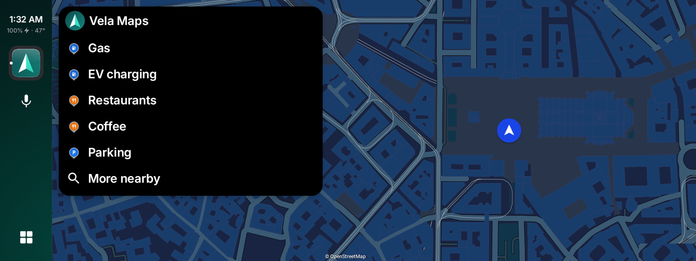
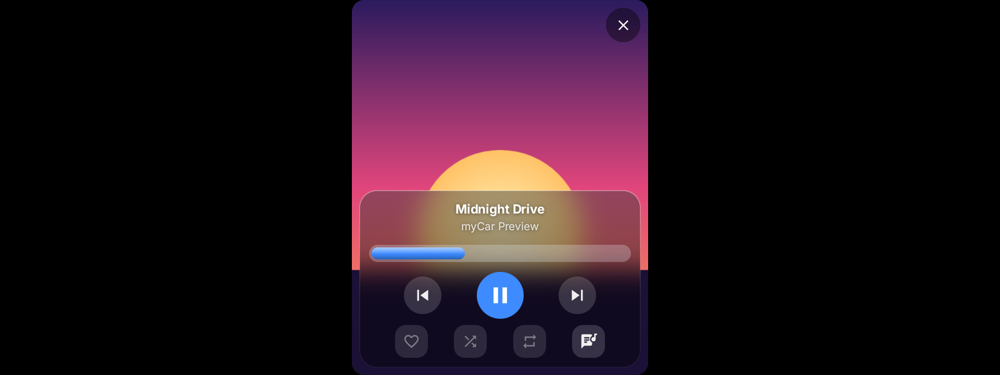
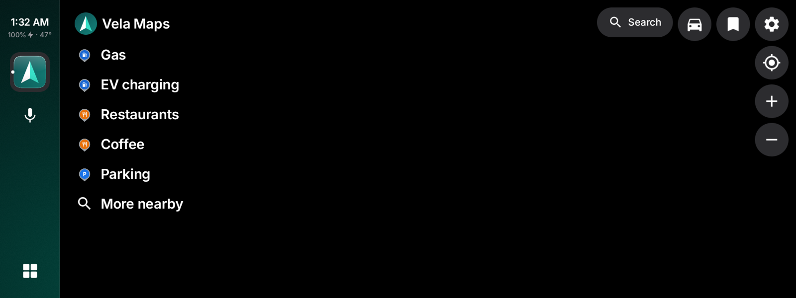

# MyCar

An Android Auto alternative for your phone, with no Google software in the path.

MyCar is an independent fork of [Gearslip](https://github.com/twinksoftware/gearslip) by
Twink Software LLC. It keeps Gearslip's license (AGPL-3.0) and builds on its work. See
[Based on Gearslip](#based-on-gearslip) for what changed.

[](https://apps.obtainium.imranr.dev/redirect?r=obtainium://add/https://github.com/sirionero/mycar)

## Which cars work

Most cars work. Starting around 2020, some cars added newer security standards that reject
the Android Auto certificate MyCar uses, and MyCar can't run in those cars. [CARS.md](CARS.md)
lists the cars drivers have confirmed with Gearslip; MyCar talks to cars with the same code.

## What MyCar is

MyCar is an Android Auto client for the phone. It speaks the Android Auto protocol
directly to a car head unit, over USB or wirelessly, with no Google software in the path.
MyCar acts as a Car App Library host: an app that ships a car interface hands MyCar
a template, and MyCar renders that template natively on the car screen. Nothing is
mirrored from the phone. For apps without a car interface, MyCar offers a separate
screen-sharing mode.

The screenshots below still show Gearslip's look. MyCar is getting a new design.

| | |
|---|---|
|  |  |
| Your car apps in one place. A red X marks the ones that don't work yet. | Vela Maps navigating, with the player beside it. |
|  |  |
| ViVi Music in the built-in player. | A new message, read aloud at a tap, over the map. |
|  |  |
| The weather, your next event, and what you missed. | Browse the web while parked. |
|  |  |
| Ask for a place, a song, or an app. | Find coffee nearby without leaving the map. |

## Features

- **Phone calls.** Dial from a keypad, or search your contacts, then confirm before the
  call goes out. When a call comes in, answer or decline it on the car screen.
- **Navigation.** MyCar hosts real Car App Library map apps on the car screen.
  Organic Maps, OsmAnd, and Flitsmeister work today. Vela runs, with rough
  edges.
- **Music.** Browse, play, and queue tracks from a car-enabled media app, with a Now
  Playing view, an Up Next queue, and lyrics. Type a search, and apps that accept one
  play the best match.
- **The web.** A browser template with its own on-screen keyboard, for anything that
  doesn't ship a car interface of its own.
- **Weather and the day ahead.** A dashboard screen shows the week's calendar next to
  the current and coming weather.
- **Voice.** Tap the mic, or press the talk button on the wheel, and say "navigate to the
  nearest gas station", "play Daft Punk", or "call Mom". Say "help" for the full list.
  Speech turns into text on the phone, and nothing you say leaves it.
- **Messages.** New messages appear as a small card on the car screen. MyCar reads
  each one aloud, and you reply by voice or with a quick reply. Music pauses while
  MyCar speaks or listens. Speech runs on the phone, so it needs no Google account.
- **Notifications.** Only messages, missed calls, alarms, and reminders interrupt you.
  The rest wait on the dashboard.
- **Your apps, your order.** The launcher groups apps by kind: phone, maps, music,
  messaging, and the rest. Press and hold an app to move it.
- **Car controls.** Steering wheel buttons, control knobs, and D-pads all work.
- **Themes.** Choose flat buttons or skeuomorphic ones that look like real keys.

## Status

- **Wired or wireless.** Plug the phone into the car's USB port, or, in a car with wireless
  Android Auto, tap Connect wirelessly and pick the car. Pair the phone with the car over
  Bluetooth first.
- **Setup walks you through it.** First launch asks for the Android Auto certificate,
  then one permission at a time, each with a plain reason and an Allow or Skip. A help
  screen inside the car answers anything setup didn't cover.
- **Templated apps work.** MyCar renders all 16 template types that the Car App
  Library defines, and it draws its own keyboard for search, sign-in, and text fields.
- **It works with [LIVI](https://github.com/f-io/LIVI),** the open-source head unit
  used in homemade car dashboards, as Gearslip does.
- **Some apps refuse MyCar.** Spotify, Waze, and Google Messages use a version of
  Google's car library that accepts only Android Auto itself. Spotify still plays through
  MyCar's own player. Apps that list trusted hosts by package and signing certificate
  need to add MyCar to that list; see [docs/BUILDING_APPS.md](docs/BUILDING_APPS.md).
- **MyCar can't be installed next to Gearslip.** Both define the permission that car apps
  look for, and Android lets only one signing key define it. Uninstall Gearslip first.
- **Calls use the car's Bluetooth,** as they do in Android Auto. Pair the phone with the
  car to hear calls through its speakers.
- **Music reaches the car over Bluetooth or USB.** Setup asks which. Bluetooth is the
  default: Android never asks for permission, and your map app's voice reaches the car
  too. USB sounds a little clearer, with no delay, but Android shows a screen-share
  consent dialog once per drive. MyCar never reads the screen; capturing playback is
  the only way an ordinary app can pass another app's audio along.
- **MyCar needs no adb, root, or Shizuku.** Every feature relies on an ordinary
  Android permission or an on-device consent dialog. For USB audio, setup offers two
  optional adb commands: one removes the audio dialog for good, and the other keeps
  notifications visible while audio plays.
- **Updates come from GitHub.** Once a day, MyCar checks this repository's latest
  release. When a new version is out, it downloads the APK, checks it against GitHub's
  SHA-256, and installs it through Android's own installer. Turn off automatic checks in
  Settings.
- **No usage data.** MyCar sends no usage notes or statistics.

## Contributing

Bug reports from real cars help most, and pull requests are welcome.
[CONTRIBUTING.md](CONTRIBUTING.md) explains what to put in a report.

## Building

```
./gradlew :app:assembleDebug
```

The APK lands at `build/MyCar-debug.apk`.

A release build needs a signing key. Copy `keystore.properties.example` to
`keystore.properties`, fill in your own values, and run
`./gradlew :app:assembleRelease`. Git ignores both the properties file and the
keystore. Without them, the debug build still works.

## Writing apps for MyCar

[docs/BUILDING_APPS.md](docs/BUILDING_APPS.md) specifies how to write apps that MyCar
can render: templated apps, media apps, and the app protocol inherited from Gearslip.

## How MyCar talks to cars

MyCar is an independent program, written to work with car head units. What it knows of
the protocol comes from Gearslip and from public open-source projects such as
[aasdk](https://github.com/opencardev/aasdk) and open-android-auto, and it contains none
of Google's Android Auto code.

MyCar ships without a certificate. On first launch you choose where yours comes from:
download the one the aasdk project publishes, or import a file of your own. The
certificate stays on your phone. MyCar never uploads, backs up, or logs it.

## Based on Gearslip

MyCar is a modified version of [Gearslip](https://github.com/twinksoftware/gearslip),
Copyright (C) 2026 Twink Software LLC and contributors, released under the GNU Affero
General Public License v3.0. MyCar does not take updates from Gearslip and is not
affiliated with, endorsed by, or sponsored by Twink Software LLC.

Changes since October 26, 2026, when MyCar forked Gearslip 0.3.01-alpha:

- New name, package name (`io.github.sirionero.mycar`), and source repository.
- Updates come from this repository's releases.
- No usage notes: MyCar has no stats server and never asks to send them.
- The About screen credits Gearslip and shows the license.

The full list of changes is this repository's commit history.

## Trademarks

Android, Android Auto, Google Messages, and Waze are trademarks of Google LLC. Spotify is
a trademark of Spotify AB. Gearslip is a name of Twink Software LLC. MyCar is not
affiliated with, endorsed by, or sponsored by any of these companies. All other names
belong to their owners.

## License

MyCar is free software under the GNU Affero General Public License v3.0; see
[LICENSE](LICENSE) and [NOTICE.md](NOTICE.md). It comes with no warranty.
