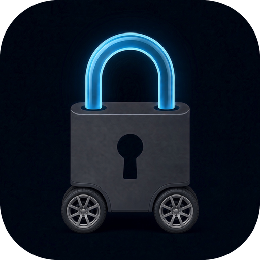
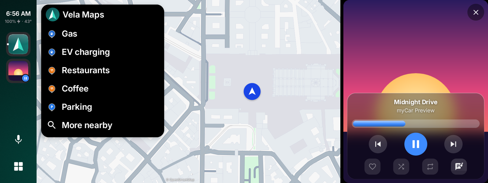
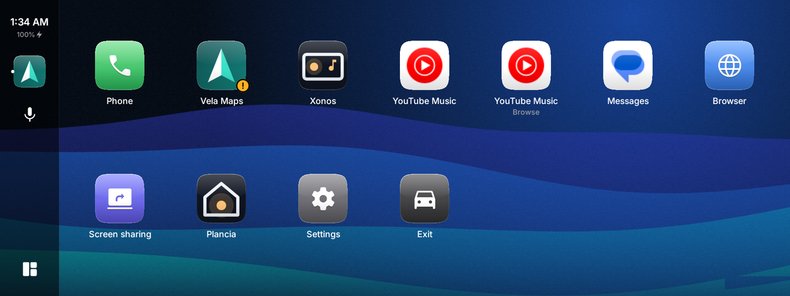
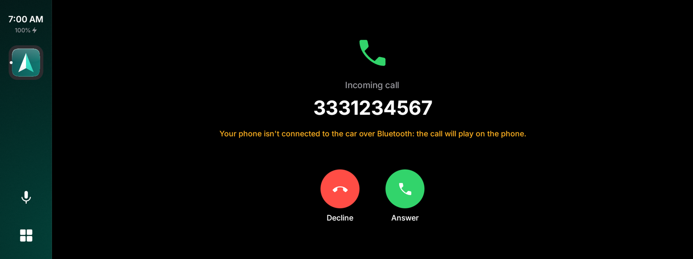
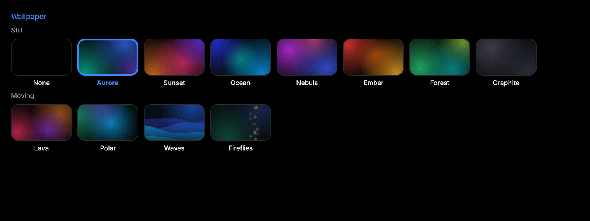
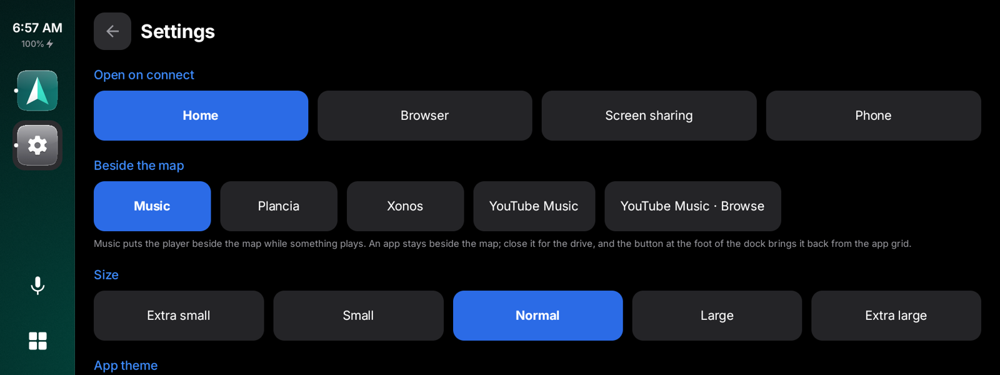

# myCar

An Android Auto alternative for your phone, with no Google software in the path.

myCar is an independent fork of [Gearslip](https://github.com/twinksoftware/gearslip) by
Twink Software LLC. It keeps Gearslip's license (AGPL-3.0) and builds on its work. See
[Based on Gearslip](#based-on-gearslip) for what changed.

[](https://apps.obtainium.imranr.dev/redirect?r=obtainium://add/https://github.com/sirionero/mycar)

## What's new in 0.7

Everything the 0.6 releases brought, together in 0.7, and **220 bugs found and fixed since 0.6.0**
(counted commit by commit; 158 of them had reached a published version), among them the crash that
closed myCar on the Home pages. We chart our own course: **pirate speak** (Settings > Language >
Pirate speak) rewrites every text of myCar the pirate way, in each of its languages, and the new
moving wallpaper **myCar · Rebel** sails a pirate ship through the waves, one that rides out every
storm.

First of all, **myCar speaks your language**:
English, Italian, Spanish, German, French, Portuguese, Greek, Russian or Chinese, on the phone, on
the car's screen and in the voice assistant. It follows the phone, or takes the one picked in
Settings > Language.

**In the car**
- **A mini player over the whole map.** Close the player beside the map and a small one floats
  over the map: the cover, back, play or pause, and next. Hold it, then drag it anywhere; its X
  hides it for the drive.
- **The player beside the map in four sizes,** from Small to Extra large.
- **Hide apps from the app grid:** hold one and choose "Hide from the app grid". The car's
  Settings > Hidden apps, or the phone's Settings > Car screen, brings it back.
- During a call the screens move below the call's bar, so Back, the tabs and Stop stay within
  reach. The car's keyboard pastes what you copied on the phone.

**Music**
- **Spotify and other services inside myCar.** In the phone's Settings > Music, switch on Spotify,
  or add YouTube Music, Amazon Music, Deezer, TIDAL, SoundCloud, Qobuz and more. Each plays inside
  myCar from its own web player, so the sound reaches the car through myCar even where the
  service's app won't pass it along. You sign in on the phone with your own account, and some
  services play only with a paid subscription.
- **Song lyrics found far more often,** and checked against the title, the artist and the length
  before they show, so they belong to the song that's playing. Instrumental tracks say so; with
  Xonos, Music Assistant's own lyrics come first.
- **A sound button in the player** shows whether the music reaches the car over Bluetooth or
  through myCar; a tap switches it, and myCar remembers the choice for each car.
- **Autoplay is on by default** (if you had turned it off, it stays off). When the car takes the
  speakers for its own voice and forgets to give them back, myCar asks for them again; after a
  "no" to Android's audio question, the player says so and offers "Ask again".

**Maps**
- **The map gets your position with the phone locked in your pocket:** myCar takes it for the
  map as the car arrives. If Android still refuses, the car says so, only when you're stopped.
- **The map starts at its final width and stays put** when the music changes, so Vela and the
  other maps don't draw everything twice. Beside the player, routes and results no longer end up
  behind the map app's list card.

**Assistant and voice**
- **The assistant in all nine languages:** Greek and Russian are heard by the multilingual
  Parakeet model, Chinese by Whisper; Settings > Voice says which one to download. Listening in
  Greek, Russian and Chinese hasn't been tried on a real phone yet.
- **Home Assistant answers what myCar can't.** With Plancia set up, other questions go to the
  voice assistant you chose in Home Assistant (Claude, Gemini, ChatGPT, a model at home, or its
  own, which runs the house), in your language, follow-ups included, with the phone locked too.
- The assistant always closes by itself when it's done, a phrase in another language is no longer
  cut while you're still speaking, and nothing listens while a call rings.

**Connecting**
- **Connecting wirelessly by itself, sturdier:** myCar keeps calling the car while the car's
  system starts up, starts over by itself when a step fails, and after a drive keeps listening
  for the car, so a short stop reconnects. With the phone in a pocket it stays awake while it
  waits, and joins the car's Wi-Fi, which Android used to refuse it.
- **Messages that say the real cause:** the certificate, the car's date, the phone's Wi-Fi turned
  off, a cable start that stalls (with what to do), a car screen that can't be drawn.

**On the phone**
- **Every setting of the car's screen is on the phone too,** in Settings > Car screen, pages
  beside the map and the apps on the car's grid included. Car preview, at the top of Settings,
  shows the car's screen on the phone.
- **Settings in groups,** and **themes**: like the phone, Light, Dark, Black (AMOLED) or Monokai.
- After each update a pirate flag flies with the new version, and a new release line such as 0.7
  opens with the pirate ship.

Most of this has been checked in the Android emulator and in automated tests, and only part of it
in a real car: if something doesn't work in yours, a report helps (see
[Contributing](#contributing)). Every change, release by release, is in
[Releases](https://github.com/SirioNero/MyCar/releases) and in the app, under Settings > About >
What's new.

## Which cars work

Most cars work. Starting around 2020, some cars added newer security standards that reject
the older Android Auto certificates. For those myCar can use CarService, Android Auto's own
current certificate, which works in a recent Volkswagen; a car that turns down that one too can't
run myCar. [CARS.md](CARS.md) lists the cars drivers have confirmed with Gearslip; myCar talks to
cars with the same code.

On the phone, myCar needs Android 12 or newer. It needs no Google Play Services and no Google
account of its own.

## What myCar is

myCar is an Android Auto client for the phone. It speaks the Android Auto protocol
directly to a car head unit, over USB or wirelessly, with no Google software in the path.
myCar acts as a Car App Library host: an app that ships a car interface hands myCar
a template, and myCar renders that template natively on the car screen. Nothing is
mirrored from the phone. For apps without a car interface, myCar offers a separate
screen-sharing mode.

myCar has an infotainment-style look of its own: a dock down the left, a paged app grid, the
Inter typeface, a dark theme by default, app icons in a rounded-square frame, and wallpapers
behind it all — still or moving.



*Home: your map, with the music beside it, or an app you choose.*

| | |
|---|---|
|  |  |
| Your car apps in one place, over a moving wallpaper. | Answer or decline a call from the car. |
|  |  |
| Still or moving wallpapers, all drawn by myCar. | What sits beside the map, and the player's size, in the car's settings. |

## Features

- **Your language.** myCar on the phone and on the car screen, and its voice assistant, in
  English, Italian, Spanish, German, French, Portuguese, Greek, Russian or Chinese: the phone's
  language, or another one picked in Settings > Language.
- **Phone calls.** Your recent calls, missed ones in red; your contacts, favourites first; a
  keypad. Tap, then confirm before the call goes out. When a call comes in, answer or decline
  it on the car screen; a missed call's card offers to call back.
- **Navigation.** myCar hosts real Car App Library map apps on the car screen.
  Organic Maps, OsmAnd, Flitsmeister, and Vela Maps work today. myCar takes the phone's position
  for the map as the car arrives, so the map has it even with the phone locked in your pocket,
  and the map starts at its final width beside the music instead of being drawn twice.
- **Music.** Browse, play, and queue tracks from a car-enabled media app, with a Now
  Playing view, an Up Next queue, and lyrics. Type a search, and apps that accept one
  play the best match. The player looks like a recent phone's: plain controls, a thin line
  to seek, the cover's colours behind it, and the cover in sight while you browse. Its sound
  button shows whether the music reaches the car over Bluetooth or through myCar, and a tap
  sends it the other way; myCar remembers the choice for each car. Autoplay starts the music
  with the drive (on by default).
- **Lyrics.** Lyrics from [LRCLIB](https://lrclib.net), a free archive written by listeners,
  full screen or beside the map, following the song where the archive has them timed. myCar
  cleans the title of what apps and radios add ("Remastered", "feat.", "Live", "Official
  Video") and checks every result against the title, the artist and the length before showing
  it; instrumental tracks say so. With Xonos, Music Assistant's own lyrics come first. A song
  with no lyrics shows one short line, and beside the map the player comes back by itself.
- **The web.** A browser template with its own on-screen keyboard, for anything that
  doesn't ship a car interface of its own. The keyboard pastes what you copied on the phone, and
  copies from the page, in Cinema and the music services too.
- **Your music library.** Xonos, built in: your Music Assistant library among the car's music
  apps — everything Music Assistant plays, from your own files to the services you added to it.
  With the car audio through myCar, its sound goes straight to the car, and Android doesn't ask
  to share the audio while you listen to it. Sign in on the phone, or bring your account over
  from the Xonos app with one tap.
- **Spotify and other services, inside myCar.** Switch on Spotify in the phone's Settings >
  Music, or add YouTube Music, Amazon Music, Deezer, TIDAL, SoundCloud, Qobuz and more. Each one
  plays inside myCar from the service's own web player, laid out as on a computer, so its sound
  reaches the car through myCar even where the service's app won't let it be passed along. Sign
  in once on the phone with your own account, using its keyboard and password manager, and the
  car stays signed in; what plays is what the service's web player allows that account, and some
  services play only with a paid subscription. They work like any music app: the song beside the
  map and in the dock, the steering wheel buttons, and the voice assistant, which searches the
  service and plays the first result. "Hide the phone's Spotify app" keeps one Spotify on the
  car's grid, not two. When Spotify is playing on another device, the car says so.
- **Your home.** Plancia, built in: your Home Assistant dashboards in the car, connected from
  the start of the drive and kept loaded, so they're there the moment you open them — full
  screen from the app grid, on a page beside the map, or beside the map itself. Set it up in
  myCar's settings on the phone, or bring your account over from the Plancia app with one tap.
- **Cinema.** Your video sites as tiles, each with the icon it gives itself: YouTube, RaiPlay
  and Twitch to start with, and any you add on the phone, your own Jellyfin included. Each opens
  in a browser made for video: full screen when the player asks for it, the car's keyboard for
  searching, a site's computer layout when you prefer it. Next to the sites, the videos on your
  phone (they start again where you left them) and TV: add an IPTV list (M3U) from your provider, a
  public list or a TV server at home, and its channels show with their logos and groups. Both play
  on Android's own player, with nothing extra to install. Video shows only when the car is parked:
  while it moves the picture is covered and the sound carries on. That's a setting, on by default,
  which myCar strongly advises keeping on. Protected video (Netflix, Prime Video, Disney+, DAZN)
  most likely stays black in the car: Android hides it from a screen sent to the car as video.
- **Plancia and Xonos with Tailscale, wirelessly too.** Over wireless myCar has to be left out of
  Tailscale, so the built-in Plancia and Xonos reach your servers through the Plancia and Xonos
  apps on the phone, which stay inside it: set the apps to the same addresses. When even that
  fails - a wrong address or token - the apps take their place for the drive, by themselves.
- **Weather and the day ahead.** A dashboard screen shows the week's calendar next to
  the current and coming weather.
- **Voice.** Tap the mic, or press the talk button on the wheel, and say "navigate to the
  nearest gas station", "play Daft Punk", "call Mom on mobile", "call back", "read my messages",
  "reply to Anna" or "when do I arrive?". Say "help" for the full list. The assistant listens
  and answers in myCar's language, any of its nine, once the speech model that knows it is on
  the phone (Settings > Voice). With Home
  Assistant set up (Plancia), what myCar can't do itself goes to the voice assistant you chose in
  Home Assistant - Claude, Gemini, ChatGPT, a model at home, or its own, which runs the house - also
  with the phone locked in your pocket.
  Speech turns into text on the phone, and nothing you say leaves it, except what goes to your
  Home Assistant, as text, when it's set up. Prefer your own
  assistant? Choose the phone's — Gemini, Google, Claude, and the rest — and myCar wakes it
  the way the swipe up from a bottom corner of the phone does, rather than in a typed chat.
  With the phone locked, myCar lights it and asks you to unlock it, and the assistant starts
  listening as soon as it opens.
- **Messages.** New messages appear as a small card on the car screen. myCar reads
  each one aloud, and you reply by voice or with a quick reply - written in myCar's
  language. Music pauses while myCar speaks or listens. Speech runs on the phone, so it
  needs no Google account.
- **Notifications.** Only messages, missed calls, alarms, and reminders interrupt you.
  The rest wait on the dashboard.
- **Your apps, your order.** The launcher groups apps by kind: phone, maps, music,
  messaging, and the rest. Press and hold an app to move it, or to hide it from the grid; it
  comes back from the car's Settings > Hidden apps, or from the phone.
- **Car controls.** Steering wheel buttons, control knobs, and D-pads all work.
- **A look of its own.** A dock down the left with the clock and your apps, a paged app grid,
  app icons in a rounded-square frame with a soft glass shine, and the Inter typeface. Dark by
  default; choose light or follow the phone.
- **Wallpapers.** Pick one of myCar's own behind the grid and the dashboard — still, or moving
  (Lava, Polar, Waves, Fireflies). They're drawn by myCar, not shipped as pictures.
- **Beside the map.** When music plays, the player shares the screen with the map, its cover
  filling its side on frosted glass. Tap the song in the dock to put it away or bring it back;
  the dock's foot brings map and music back from the app grid. Or pick an app to stay beside
  the map instead, such as Plancia for your home or Xonos for your music. The player comes in
  four sizes: Small, Medium, Large and Extra large.
- **A mini player over the whole map.** Close the player beside the map while music plays, and
  a small one floats over the map: the cover (a tap opens the full player), back, play or pause,
  and next. Hold it, then drag it anywhere; it stays there on the next drives. It lies under the
  map app's own cards and buttons, and every touch outside it still reaches the map. Its X hides
  it for the drive, and the car's settings can turn it off.
- **Pages beside the map.** Swipe across Home, or tap the dots at its foot, for pages either side
  of the map: a whole page, two halves, four parts, a half beside two quarters, or a wide strip
  above or below two quarters, holding the weather, your agenda, the browser, Plancia's
  dashboard, or a car app. Ready-made, the weather and the agenda sit left of the map
  and Plancia beside the browser on its right; the pencil beside the dots changes a page.
- **Pick your size.** Scale the whole car screen from Extra small to Extra large, for the car's
  display and your eyes.
- **Themes.** Choose flat buttons or skeuomorphic ones that look like real keys. On the phone,
  myCar follows the phone's light or dark look, or takes Light, Dark, Black (AMOLED) or Monokai.
- **The car's settings on the phone too.** Every setting of the car's screen is on the phone as
  well, in Settings > Car screen, pages beside the map included: change one on either side and
  the other follows at once, during a drive too. At the top of the phone's Settings, Car preview
  shows the car's screen on the phone, to try it without a car.

## Status

- **Wired or wireless.** Plug the phone into the car's USB port, or, in a car with wireless
  Android Auto, tap Connect wirelessly and pick the car. Pair the phone with the car over
  Bluetooth first. After a drive without the cable Android asks once, and from then on the car
  connects by itself when it starts, with the phone in your pocket (Settings > Connection >
  Connect wirelessly by itself). A start that fails tries again by itself, and after a drive
  myCar keeps listening for the car for a while, so a short stop reconnects.
- **With the cable on GrapheneOS,** the USB-C port has to let data through, or the car sees
  only a phone to charge: in Settings > Security & privacy > Exploit protection > USB-C port,
  Charging-only keeps the car out, and with Charging-only when locked, the default, unlock the
  phone when you plug it in. When the phone charges but no car answers, Home says what to check.
- **Setup is one list.** First launch shows what's needed to connect and what the drive
  needs, with a tick on what's done and one button for the next step: get the certificates,
  then allow calls, map and music in one go. Car audio sits beside them, with what each way
  means at every drive: Android's question, the car's radio. "Take me back to the initial
  setup", in How to connect, opens the same list later, with nothing deleted or reset. A help
  screen inside the car answers anything setup didn't cover.
- **Templated apps work.** myCar renders all 16 template types that the Car App
  Library defines, and it draws its own keyboard for search, sign-in, and text fields.
- **It works with [LIVI](https://github.com/f-io/LIVI),** the open-source head unit
  used in homemade car dashboards, as Gearslip does.
- **Some apps refuse myCar.** Spotify, Waze, and Google Messages use a version of
  Google's car library that accepts only Android Auto itself. The Spotify app still plays
  through myCar's own player, but its sound reaches the car only over Bluetooth: it won't let
  another app pass it along. Spotify inside myCar reaches the car either way. Apps that list
  trusted hosts by package and signing certificate need to add myCar to that list; see
  [docs/BUILDING_APPS.md](docs/BUILDING_APPS.md). Waze modified with Morphe accepts myCar once
  its "Allow Gearslip" patch lists it: in the patch's "Accepted hosts" option, add a `;` and
  `e477a4794b984927360e9ae4a31e87cb08a26c54e0e27e4334116d1c7cdccc31,io.github.sirionero.mycar`
  after Gearslip's entry (`*,io.github.sirionero.mycar.dev` for myCar's debug build), then patch
  Waze again. A modified Waze that refuses myCar gets a red X, and the car says what to add.
  Any other app whose own list of hosts leaves myCar out (ABRP, for one) gets a red X too and no
  longer starts by itself, and the car says that only its developer can change that: its tile
  still tries it, and an update of the app clears the mark.
- **myCar can't be installed next to Gearslip.** Both define the permission that car apps
  look for, and Android lets only one signing key define it. Uninstall Gearslip first.
- **Calls use the car's Bluetooth,** as they do in Android Auto. Pair the phone with the
  car to hear calls through its speakers.
- **Music reaches the car over Bluetooth, or through myCar.** Automatic, the default, uses
  Bluetooth when the car takes the phone's music that way, and otherwise sends it through
  myCar's own link to the car, over the cable or Wi-Fi, as Android Auto does: many cars take
  only calls over Bluetooth while Android Auto runs. Bluetooth never needs a permission, and
  your map app's voice reaches the car too. Through myCar, Android shows a screen-share
  consent dialog once per drive, one tap with no app to pick, which a one-time adb command
  removes; not while you listen to Xonos, which myCar plays itself. When the car takes its speakers for a call or a prompt, the music comes back after.
  After a "no" to that dialog, the player says the music isn't reaching the car and offers "Ask
  again". myCar never reads the screen; capturing playback is the only way an ordinary app can
  pass another app's audio along.
- **myCar needs no adb, root, or Shizuku.** Every feature relies on an ordinary
  Android permission or an on-device consent dialog. For sound through myCar, How to connect
  has two optional adb commands: one removes the audio dialog for good, and the other keeps
  notifications visible while audio plays. Setup's car audio step shows the first one too.
- **Updates come from GitHub.** Once a day, myCar checks this repository's latest
  release. When a new version is out, it downloads the APK, checks it against GitHub's
  SHA-256, and installs it through Android's own installer. Turn off automatic checks in
  Settings.
- **No usage data.** myCar sends no usage notes or statistics.

## Verify your download

Check that your copy of myCar is genuine with
[AppVerifier](https://github.com/soupslurpr/AppVerifier): share this block to it, or compare it
with the output of `apksigner verify --print-certs`.

```
io.github.sirionero.mycar
E4:77:A4:79:4B:98:49:27:36:0E:9A:E4:A3:1E:87:CB:08:A2:6C:54:E0:E2:7E:43:34:11:6D:1C:7C:DC:CC:31
```

## Support myCar

myCar is free, with no ads and no tracking. To support it, send any amount of Bitcoin to:

```
bc1qu8q2sc5kuccjj3zpzzfpj85xn7szp73nae9xlx
```

The app shows the same address under Settings, with buttons to open your wallet or copy it.

## Contributing

Bug reports from real cars help most, and pull requests are welcome.
[CONTRIBUTING.md](CONTRIBUTING.md) explains what to put in a report.

## Building

```
./gradlew :app:assembleDebug
```

The APK lands at `build/myCar-debug.apk`.

A release build needs a signing key. Copy `keystore.properties.example` to
`keystore.properties`, fill in your own values, and run
`./gradlew :app:assembleRelease`. Git ignores both the properties file and the
keystore. Without them, the debug build still works.

## Writing apps for myCar

[docs/BUILDING_APPS.md](docs/BUILDING_APPS.md) specifies how to write apps that myCar
can render: templated apps, media apps, and the app protocol inherited from Gearslip.

## How myCar talks to cars

myCar is an independent program, written to work with car head units. What it knows of
the protocol comes from Gearslip and from public open-source projects such as
[aasdk](https://github.com/opencardev/aasdk) and open-android-auto, and it contains none
of Google's Android Auto code.

myCar ships without a certificate. On first launch, Get certificates downloads three public
ones from GitHub: the one [aasdk](https://github.com/opencardev/aasdk) publishes, recommended,
the one in [Headunit Revived](https://github.com/andreknieriem/headunit-revived), as a spare,
and CarService, Android Auto's own, from the
[android-auto-certificates](https://github.com/Iscle/android-auto-certificates) archive, for
the cars that check phones most strictly. myCar checks each before keeping it - the first two
against their fingerprints, CarService against the Google root that signs all three - and if
your car turns down one, it uses the next. Android Auto replaces CarService every few months:
myCar gets the new one before the old one runs out. You can also pick one in Settings, or
import a file of your own. Certificates stay on your phone. myCar never uploads, backs up, or
logs them.

## Based on Gearslip

myCar is a modified version of [Gearslip](https://github.com/twinksoftware/gearslip),
Copyright (C) 2026 Twink Software LLC and contributors, released under the GNU Affero
General Public License v3.0. myCar does not take updates from Gearslip and is not
affiliated with, endorsed by, or sponsored by Twink Software LLC.

Changes since October 26, 2026, when myCar forked Gearslip 0.3.01-alpha:

**Identity**
- New name, icon, package name (`io.github.sirionero.mycar`), signing key, and source repository.
- Updates come from this repository's releases, checked against GitHub's own SHA-256.
- No usage notes: myCar has no stats server and never asks to send them.
- The About screen credits Gearslip and shows the license; donations go to myCar's Bitcoin address.

**A new design (the `car/design` system)**
- A side dock with the clock, the dashboard, the map, what's playing, and your pinned and open
  apps, with the assistant's microphone and the app-grid button always in place at its foot.
- A paged app grid, with real app icons in a rounded-square (squircle) frame, and a soft glass
  shine on icons and on the player's controls.
- The Inter typeface, a dark theme by default (light or follow-the-phone optional), and myCar's
  own colours, radii, and motion, all from one place.
- Wallpapers drawn by myCar — still (Aurora and six more) or moving (Lava, Polar, Waves,
  Fireflies) — behind the grid and the dashboard, with the dock in glass over them.
- A player in the style of recent phones: plain controls, a thin seek line, and the cover's
  colours behind the full-screen player, with the cover in sight while you browse.
- The player sits beside the map when music plays, its cover filling its side on frosted glass,
  in four sizes; the dock's foot returns to map-and-music from the grid. An app of your choice can
  take that place instead: a car app runs there, or a music app shows its player. Closed, it
  leaves a mini player floating over the whole map, moved by holding and dragging it.
- Home's pages either side of the map, swiped to or reached by the dots at its foot: whole, in
  halves, in quarters or a half or strip beside two quarters, holding the weather, the agenda, the
  browser or a car app, changed in place.
- The whole car screen scales from Extra small to Extra large.
- Material Symbols icons and the Inter typeface ship as files inside the app, with no new
  dependencies.

**Features and fixes**
- myCar in nine languages, the Xonos app's: English, Italian, Spanish, German, French,
  Portuguese, Greek, Russian and Simplified Chinese, on the phone, on the car screen and in the
  voice assistant, following the phone or picked in Settings > Language.
- Built in, beside the car apps: Plancia (Home Assistant), Xonos (Music Assistant), Cinema, and
  Spotify and other music services from their own web players.
- Every setting of the car's screen is on the phone too, pages beside the map included; apps can
  be hidden from the car's grid.
- A car that worked without the cable connects again by itself when it starts, tries again by
  itself when a start fails, and finds myCar listening after a short stop.
- Song lyrics from LRCLIB, with titles cleaned and every result checked against the song before
  it shows.
- The map gets the phone's position from the car's arrival, even with the phone locked, and
  starts at its final width beside the music.
- Incoming calls from contacts show on the car screen; answer, decline, or end them there, and a
  declined call no longer leaves its card stuck. myCar says when call audio stays on the phone
  because the car's Bluetooth hands-free isn't connected.
- A choice of voice assistant: myCar's own, the phone's, or another assistant app. The phone's
  is woken the way the swipe up from a bottom corner wakes it, rather than in a typed chat, and
  with the phone locked myCar asks you to unlock it first, then starts the assistant. With Home
  Assistant set up, what myCar's own assistant can't do goes to the one chosen in Home Assistant.
- Car audio finds its way each drive: Bluetooth when the car takes the phone's music that way,
  otherwise through myCar's own link to the car, over the cable or Wi-Fi. The music comes back
  after a call or the assistant, where it used to stay off until the next drive. A button in the
  player switches the way, remembered for each car.
- Screen sharing turns the phone landscape while it shows in the car, so apps fill the wide
  screen instead of standing upright between two bars.
- Car apps show their own icons again, instead of another app's.
- Vela Maps works and no longer carries a "works in part" mark.

**Toward F-Droid**
- No Google Play Services and no statistics server. A build for F-Droid is the goal; what's
  left is mostly building the offline speech library from source instead of shipping it prebuilt.

The full list of changes is this repository's commit history.

## Trademarks

Android, Android Auto, Google Messages, YouTube Music, and Waze are trademarks of Google LLC.
Spotify is a trademark of Spotify AB. Gearslip is a name of Twink Software LLC. myCar is not
affiliated with, endorsed by, or sponsored by any of these companies. All other names
belong to their owners.

## License

myCar is free software under the GNU Affero General Public License v3.0; see
[LICENSE](LICENSE) and [NOTICE.md](NOTICE.md). It comes with no warranty.
