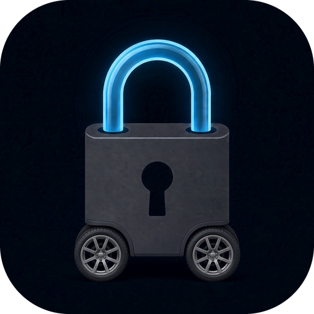
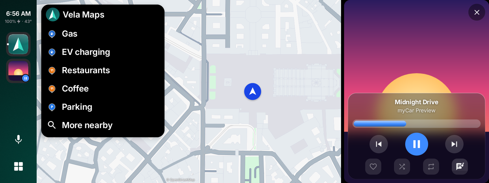
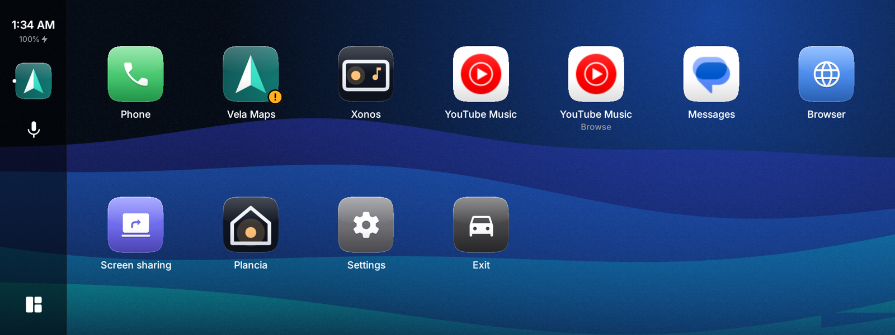
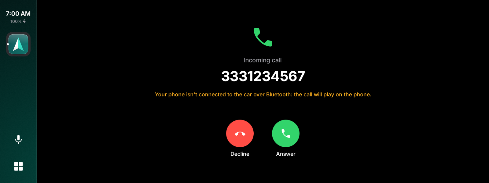
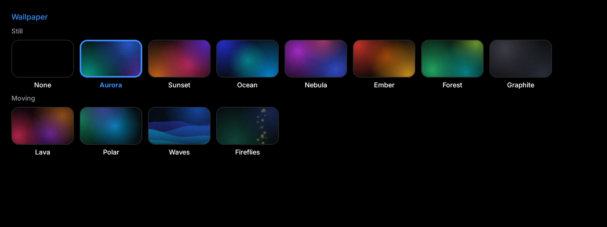
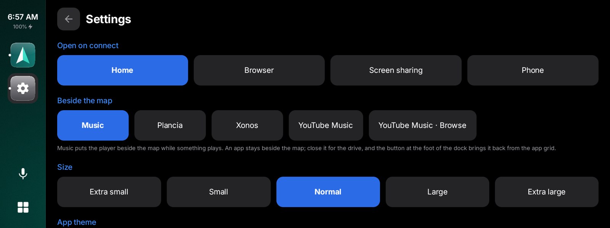

# myCar

An Android Auto alternative for your phone, with no Google software in the path.

myCar is an independent fork of [Gearslip](https://github.com/twinksoftware/gearslip) by
Twink Software LLC. It keeps Gearslip's license (AGPL-3.0) and builds on its work. See
[Based on Gearslip](#based-on-gearslip) for what changed.

[](https://apps.obtainium.imranr.dev/redirect?r=obtainium://add/https://github.com/sirionero/mycar)

## Which cars work

Most cars work. Starting around 2020, some cars added newer security standards that reject
the Android Auto certificate myCar uses, and myCar can't run in those cars. [CARS.md](CARS.md)
lists the cars drivers have confirmed with Gearslip; myCar talks to cars with the same code.

## What myCar is

myCar is an Android Auto client for the phone. It speaks the Android Auto protocol
directly to a car head unit, over USB or wirelessly, with no Google software in the path.
myCar acts as a Car App Library host: an app that ships a car interface hands myCar
a template, and myCar renders that template natively on the car screen. Nothing is
mirrored from the phone. For apps without a car interface, myCar offers a separate
screen-sharing mode.

myCar has an infotainment-style look of its own: a dock down the left, a paged app grid, the
Inter typeface, a dark theme by default, app icons in a rounded-square frame, and wallpapers
behind it all — still or moving.



*Home: your map, with the music beside it, or an app you choose.*

| | |
|---|---|
|  |  |
| Your car apps in one place, over a moving wallpaper. | Answer or decline a call from the car. |
|  |  |
| Still or moving wallpapers, all drawn by myCar. | What sits beside the map, and the size, in the car's settings. |

## Features

- **Phone calls.** Dial from a keypad, or search your contacts, then confirm before the
  call goes out. When a call comes in, answer or decline it on the car screen.
- **Navigation.** myCar hosts real Car App Library map apps on the car screen.
  Organic Maps, OsmAnd, Flitsmeister, and Vela Maps work today.
- **Music.** Browse, play, and queue tracks from a car-enabled media app, with a Now
  Playing view, an Up Next queue, and lyrics. Type a search, and apps that accept one
  play the best match. The player looks like a recent phone's: plain controls, a thin line
  to seek, the cover's colours behind it, and the cover in sight while you browse.
- **The web.** A browser template with its own on-screen keyboard, for anything that
  doesn't ship a car interface of its own.
- **Your music library.** Xonos, built in: your Music Assistant library among the car's music
  apps — everything Music Assistant plays, from your own files to the services you added to it.
  With the car audio through myCar, its sound goes straight to the car, and Android doesn't ask
  to share the audio while you listen to it. Sign in on the phone, or bring your account over
  from the Xonos app with one tap.
- **Your home.** Plancia, built in: your Home Assistant dashboards in the car, connected from
  the start of the drive and kept loaded, so they're there the moment you open them — full
  screen from the app grid, on a page beside the map, or beside the map itself. Set it up in
  myCar's settings on the phone, or bring your account over from the Plancia app with one tap.
- **Cinema.** Your video sites as tiles, each with the icon it gives itself: YouTube, RaiPlay
  and Twitch to start with, and any you add on the phone, your own Jellyfin included. Each opens
  in a browser made for video: full screen when the player asks for it, the car's keyboard for
  searching, a site's computer layout when you prefer it. Next to the sites, the videos on your
  phone (they start again where you left them) and TV: add an IPTV list (M3U) from your provider, a
  public list or a TV server at home, and its channels show with their logos and groups. Both play
  on Android's own player, with nothing extra to install. Video shows only when the car is parked:
  while it moves the picture is covered and the sound carries on. That's a setting, on by default,
  which myCar strongly advises keeping on. Protected video (Netflix, Prime Video, Disney+, DAZN)
  most likely stays black in the car: Android hides it from a screen sent to the car as video.
- **Plancia and Xonos with Tailscale, wirelessly too.** Over wireless myCar has to be left out of
  Tailscale, so the built-in Plancia and Xonos reach your servers through the Plancia and Xonos
  apps on the phone, which stay inside it: set the apps to the same addresses. When even that
  fails - a wrong address or token - the apps take their place for the drive, by themselves.
- **Weather and the day ahead.** A dashboard screen shows the week's calendar next to
  the current and coming weather.
- **Voice.** Tap the mic, or press the talk button on the wheel, and say "navigate to the
  nearest gas station", "play Daft Punk", or "call Mom". Say "help" for the full list.
  Speech turns into text on the phone, and nothing you say leaves it. Prefer your own
  assistant? Choose the phone's — Gemini, Google, Claude, and the rest — and myCar wakes it
  the way the swipe up from a bottom corner of the phone does, rather than in a typed chat.
  With the phone locked, myCar lights it and asks you to unlock it, and the assistant starts
  listening as soon as it opens.
- **Messages.** New messages appear as a small card on the car screen. myCar reads
  each one aloud, and you reply by voice or with a quick reply. Music pauses while
  myCar speaks or listens. Speech runs on the phone, so it needs no Google account.
- **Notifications.** Only messages, missed calls, alarms, and reminders interrupt you.
  The rest wait on the dashboard.
- **Your apps, your order.** The launcher groups apps by kind: phone, maps, music,
  messaging, and the rest. Press and hold an app to move it.
- **Car controls.** Steering wheel buttons, control knobs, and D-pads all work.
- **A look of its own.** A dock down the left with the clock and your apps, a paged app grid,
  app icons in a rounded-square frame with a soft glass shine, and the Inter typeface. Dark by
  default; choose light or follow the phone.
- **Wallpapers.** Pick one of myCar's own behind the grid and the dashboard — still, or moving
  (Lava, Polar, Waves, Fireflies). They're drawn by myCar, not shipped as pictures.
- **Beside the map.** When music plays, the player shares the screen with the map, its cover
  filling its side on frosted glass. Tap the song in the dock to put it away or bring it back;
  the dock's foot brings map and music back from the app grid. Or pick an app to stay beside
  the map instead, such as Plancia for your home or Xonos for your music.
- **Pages beside the map.** Swipe across Home, or tap the dots at its foot, for pages either side
  of the map: two halves or four parts each, holding the weather, your agenda, the browser,
  Plancia's dashboard, or a car app. Ready-made, the weather and the agenda sit left of the map
  and Plancia beside the browser on its right; the pencil beside the dots changes a page.
- **Pick your size.** Scale the whole car screen from Extra small to Extra large, for the car's
  display and your eyes.
- **Themes.** Choose flat buttons or skeuomorphic ones that look like real keys.

## Status

- **Wired or wireless.** Plug the phone into the car's USB port, or, in a car with wireless
  Android Auto, tap Connect wirelessly and pick the car. Pair the phone with the car over
  Bluetooth first.
- **Setup is one list.** First launch shows what's needed to connect and what the drive
  needs, with a tick on what's done and one button for the next step: get the certificates,
  then allow calls, map and music in one go. "Take me back to the initial setup", in How to
  connect, opens the same list later, with nothing deleted or reset. A help screen inside the
  car answers anything setup didn't cover.
- **Templated apps work.** myCar renders all 16 template types that the Car App
  Library defines, and it draws its own keyboard for search, sign-in, and text fields.
- **It works with [LIVI](https://github.com/f-io/LIVI),** the open-source head unit
  used in homemade car dashboards, as Gearslip does.
- **Some apps refuse myCar.** Spotify, Waze, and Google Messages use a version of
  Google's car library that accepts only Android Auto itself. Spotify still plays through
  myCar's own player. Apps that list trusted hosts by package and signing certificate
  need to add myCar to that list; see [docs/BUILDING_APPS.md](docs/BUILDING_APPS.md).
- **myCar can't be installed next to Gearslip.** Both define the permission that car apps
  look for, and Android lets only one signing key define it. Uninstall Gearslip first.
- **Calls use the car's Bluetooth,** as they do in Android Auto. Pair the phone with the
  car to hear calls through its speakers.
- **Music reaches the car over Bluetooth, or through myCar.** Automatic, the default, uses
  Bluetooth when the car takes the phone's music that way, and otherwise sends it through
  myCar's own link to the car, over the cable or Wi-Fi, as Android Auto does: many cars take
  only calls over Bluetooth while Android Auto runs. Bluetooth never needs a permission, and
  your map app's voice reaches the car too. Through myCar, Android shows a screen-share
  consent dialog once per drive, one tap with no app to pick, which a one-time adb command
  removes; not while you listen to Xonos, which myCar plays itself. When the car takes its speakers for a call or a prompt, the music comes back after. myCar never reads the
  screen; capturing playback is the only way an ordinary app can pass another app's audio along.
- **myCar needs no adb, root, or Shizuku.** Every feature relies on an ordinary
  Android permission or an on-device consent dialog. For sound through myCar, setup offers two
  optional adb commands: one removes the audio dialog for good, and the other keeps
  notifications visible while audio plays.
- **Updates come from GitHub.** Once a day, myCar checks this repository's latest
  release. When a new version is out, it downloads the APK, checks it against GitHub's
  SHA-256, and installs it through Android's own installer. Turn off automatic checks in
  Settings.
- **No usage data.** myCar sends no usage notes or statistics.

## Verify your download

Check that your copy of myCar is genuine with
[AppVerifier](https://github.com/soupslurpr/AppVerifier): share this block to it, or compare it
with the output of `apksigner verify --print-certs`.

```
io.github.sirionero.mycar
E4:77:A4:79:4B:98:49:27:36:0E:9A:E4:A3:1E:87:CB:08:A2:6C:54:E0:E2:7E:43:34:11:6D:1C:7C:DC:CC:31
```

## Support myCar

myCar is free, with no ads and no tracking. To support it, send any amount of Bitcoin to:

```
bc1qu8q2sc5kuccjj3zpzzfpj85xn7szp73nae9xlx
```

The app shows the same address under Settings, with buttons to open your wallet or copy it.

## Contributing

Bug reports from real cars help most, and pull requests are welcome.
[CONTRIBUTING.md](CONTRIBUTING.md) explains what to put in a report.

## Building

```
./gradlew :app:assembleDebug
```

The APK lands at `build/myCar-debug.apk`.

A release build needs a signing key. Copy `keystore.properties.example` to
`keystore.properties`, fill in your own values, and run
`./gradlew :app:assembleRelease`. Git ignores both the properties file and the
keystore. Without them, the debug build still works.

## Writing apps for myCar

[docs/BUILDING_APPS.md](docs/BUILDING_APPS.md) specifies how to write apps that myCar
can render: templated apps, media apps, and the app protocol inherited from Gearslip.

## How myCar talks to cars

myCar is an independent program, written to work with car head units. What it knows of
the protocol comes from Gearslip and from public open-source projects such as
[aasdk](https://github.com/opencardev/aasdk) and open-android-auto, and it contains none
of Google's Android Auto code.

myCar ships without a certificate. On first launch, Get certificates downloads two public
ones from open-source projects on GitHub: the one [aasdk](https://github.com/opencardev/aasdk)
publishes, recommended, and the one in
[Headunit Revived](https://github.com/andreknieriem/headunit-revived), as a spare. myCar checks
each against its fingerprint before keeping it, and if your car turns down the first, it uses
the other. You can also pick one in Settings, or import a file of your own. Certificates stay
on your phone. myCar never uploads, backs up, or logs them.

## Based on Gearslip

myCar is a modified version of [Gearslip](https://github.com/twinksoftware/gearslip),
Copyright (C) 2026 Twink Software LLC and contributors, released under the GNU Affero
General Public License v3.0. myCar does not take updates from Gearslip and is not
affiliated with, endorsed by, or sponsored by Twink Software LLC.

Changes since October 26, 2026, when myCar forked Gearslip 0.3.01-alpha:

**Identity**
- New name, icon, package name (`io.github.sirionero.mycar`), signing key, and source repository.
- Updates come from this repository's releases, checked against GitHub's own SHA-256.
- No usage notes: myCar has no stats server and never asks to send them.
- The About screen credits Gearslip and shows the license; donations go to myCar's Bitcoin address.

**A new design (the `car/design` system)**
- A side dock with the clock, the dashboard, the map, what's playing, and your pinned and open
  apps, with the assistant's microphone and the app-grid button always in place at its foot.
- A paged app grid, with real app icons in a rounded-square (squircle) frame, and a soft glass
  shine on icons and on the player's controls.
- The Inter typeface, a dark theme by default (light or follow-the-phone optional), and myCar's
  own colours, radii, and motion, all from one place.
- Wallpapers drawn by myCar — still (Aurora and six more) or moving (Lava, Polar, Waves,
  Fireflies) — behind the grid and the dashboard, with the dock in glass over them.
- A player in the style of recent phones: plain controls, a thin seek line, and the cover's
  colours behind the full-screen player, with the cover in sight while you browse.
- The player sits beside the map when music plays, its cover filling its side on frosted glass;
  the dock's foot returns to map-and-music from the grid. An app of your choice can take that
  place instead: a car app runs there, or a music app shows its player.
- Home's pages either side of the map, swiped to or reached by the dots at its foot: two halves
  or four parts each, holding the weather, the agenda, the browser or a car app, changed in place.
- The whole car screen scales from Extra small to Extra large.
- Material Symbols icons and the Inter typeface ship as files inside the app, with no new
  dependencies.

**Features and fixes**
- Incoming calls from contacts show on the car screen; answer, decline, or end them there, and a
  declined call no longer leaves its card stuck. myCar says when call audio stays on the phone
  because the car's Bluetooth hands-free isn't connected.
- A choice of voice assistant: myCar's own, the phone's, or another assistant app. The phone's
  is woken the way the swipe up from a bottom corner wakes it, rather than in a typed chat, and
  with the phone locked myCar asks you to unlock it first, then starts the assistant.
- Car audio finds its way each drive: Bluetooth when the car takes the phone's music that way,
  otherwise through myCar's own link to the car, over the cable or Wi-Fi. The music comes back
  after a call or the assistant, where it used to stay off until the next drive.
- Screen sharing turns the phone landscape while it shows in the car, so apps fill the wide
  screen instead of standing upright between two bars.
- Car apps show their own icons again, instead of another app's.
- Vela Maps works and no longer carries a "works in part" mark.

**Toward F-Droid**
- No Google Play Services and no statistics server. A build for F-Droid is the goal; what's
  left is mostly building the offline speech library from source instead of shipping it prebuilt.

The full list of changes is this repository's commit history.

## Trademarks

Android, Android Auto, Google Messages, YouTube Music, and Waze are trademarks of Google LLC.
Spotify is a trademark of Spotify AB. Gearslip is a name of Twink Software LLC. myCar is not
affiliated with, endorsed by, or sponsored by any of these companies. All other names
belong to their owners.

## License

myCar is free software under the GNU Affero General Public License v3.0; see
[LICENSE](LICENSE) and [NOTICE.md](NOTICE.md). It comes with no warranty.
